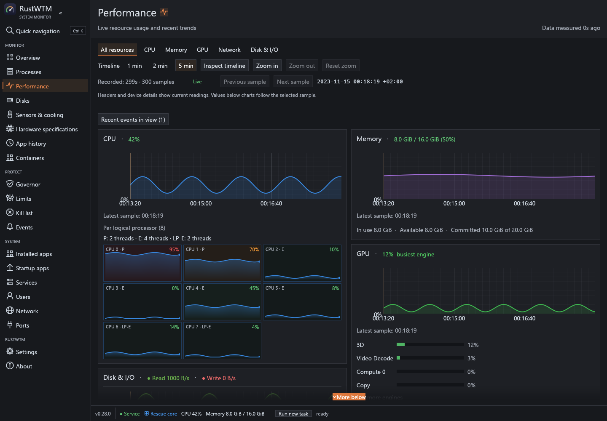

<p align="center">
  
</p>

<h1 align="center">RustWTM</h1>

<p align="center">
  <b>The Windows task manager that keeps your PC responsive.</b>
</p>

A Windows task manager written in Rust, with a background governor that keeps
the machine responsive: it throttles, caps, suspends or terminates processes
that overload the CPU, gives apps CPU and memory budgets, frees RAM under
pressure, never slows down the app you are using, and learns from long-term
usage history.

[Website](https://rustwtm.com) · [Downloads](https://github.com/rustwtm/rustwtm/releases/latest) · [Issues](https://github.com/rustwtm/rustwtm/issues)

[](https://github.com/rustwtm/rustwtm/actions/workflows/ci.yml)
[](LICENSE)
[](https://github.com/rustwtm/rustwtm/releases/latest)

> **Status:** early release. Sensors and cooling controls are available
> through the optional hardware provider. Device support varies; physical fan
> writes still require validation on each supported hardware configuration.
> Enforcement is **off by default** (dry-run); review the event log first.



[Overview resource gauges and history cards](screenshots/overview.png)

[Process workspace and inspector](screenshots/processes.png) ·
[Light theme](screenshots/processes-light.png) ·
[Compact layout](screenshots/processes-compact.png)

[Timeline inspection](screenshots/performance-timeline.png) ·
[Compact timeline](screenshots/performance-timeline-compact.png) ·
[Sampling gaps](screenshots/performance-gap.png)

[CPU tier filter](screenshots/performance-cpu.png) ·
[GPU engine search](screenshots/performance-gpu.png) ·
[Compact GPU search](screenshots/performance-gpu-compact.png)

[Product completion roadmap](docs/product-roadmap.md) · [Windows signing setup](docs/signing.md)

## New in 0.31.0

[Release scope and validation](docs/0.31.0-review.md)

- **A Windows 11 look:** rounded controls and surfaces, raised selection
  chips, soft flyouts and no needless lines: tables have no row or column
  lines unless you switch them on, and the process table has no outline.
- **Settings as option rows:** every settings page lists one option per row
  with an icon, a short description and the control at the right; on/off
  options are switches. Service policies read top to bottom.
- **Calmer charts:** no axes or tick labels, a tinted grid, the scale above
  and the time span below; rate scales move in steady steps.
- **Performance at a glance:** wide windows list the resources in a rail with
  their latest reading and a one-minute sparkline, and the timeline toolbar
  fits on one row.
- **Processes:** the resource cards form one band and the inspector tiles are
  rounded; the Limits and Kill list forms match the settings.

No settings, defaults or policies change. IPC remains protocol 16.

## Included since 0.30.4

[Release scope and validation](docs/0.30.2-review.md) · 0.30.2 and 0.30.3
were not published; 0.30.4 ships their changes with a Run new task fix.

- **Quicker process work:** hold Ctrl to freeze the list and charts for a look;
  Enter, Alt+E, Delete / Shift+Delete, Page Up/Down, Home/End and
  type-to-search on the list; names sort naturally ("app2" before "app10").
- **More to see:** service hosts name their services; Parent PID, Image path,
  Start time and Integrity columns; a memory breakdown (in use, modified,
  standby, free, kernel pools, hardware reserved); disk SMART readings, GPU
  driver details and per-core kernel time.
- **Network and lists:** Listening/Established/UDP filters, exact port search,
  owner-less and exited rows named, and pins and notes on Services, Startup and
  Network rows.
- **Windows integration:** restart Windows Explorer with the same rights; Run
  new task keeps standard rights from an elevated window; open the real Task
  Manager once while RustWTM replaces it; folder owners include programs
  working inside the folder; *Copy diagnostic information* in About.

IPC remains protocol 16.

## Included since 0.30.1

[Release scope and validation](docs/0.30.1-review.md)

- **AI assistant:** ask what a process is, whether it is safe to end and what
  slows the PC down, with your own key for Claude, OpenAI, Gemini, OpenRouter,
  Groq, DeepSeek, Mistral, xAI or a local model (Ollama, LM Studio). The model
  may look up more with read-only tools; secrets are masked, keys are sealed
  with DPAPI and it never gets control. Also `wtm ai` and new MCP tools.
- **Process workspace:** User name, Architecture, Elevated and File version
  columns, a *Hide system processes* switch, collapsible tree nodes with
  Expand/Collapse all, and grouping by user with *Sign out…*.
- **Calmer alerts and safer suspend:** the overload alert closes itself once the
  load is back to normal (*Keep it open* stops the countdown), and suspending
  asks for confirmation first.

IPC remains protocol 16.

## Included since 0.30.0

[Release scope and validation](docs/0.30.0-review.md)

- **Quick setup:** a skippable five-step welcome flow on first use and after
  updates, with a compact review, direct section editing and remembered choices.
- **Process workspace:** optional descriptive titles beside muted executable
  names, independent table separators, grouped column menus and width fitting.
- **Desktop consistency:** full-width Settings, shared row density, aligned
  controls, contextual copy/actions, and Startup search and enabled/disabled filters.
- **Reliable startup:** restored window geometry respects the minimum size;
  zero-size native frames defer layout safely. Reduced motion also covers
  automatic scrolling, and setup errors remain visible above the review.

IPC remains protocol 16. Existing repository-identity-based updates continue to
discover the current release and its paired installer/checksum assets.

## Included since 0.29.0

[Release scope and validation](docs/0.29.0-review.md)

Device workspaces/health, Store and reviewed package updates, persistent incident
replay, file-owner investigation, visual rules and numeric tray icons are now
included. See the [implementation scope and limits](docs/product-expansion.md).

- **Device workspaces:** disk health and NVMe lifetime counters, battery readings,
  GPU engines and memory charts, device sparklines and RAM composition.
- **Applications:** current-user Store registrations and optional signed WinGet
  discovery with explicit source/ID/version review before interactive updates.
  A launched installer still requires a refreshed inventory to confirm success;
  installer execution validation remains limited. Portable apps are not scanned.
- **Incident replay and file owners:** bounded persistent resource/contributor
  history with protection events, plus local file/folder owner investigation.
- **Visual policies and first use:** rule editing, pure-engine preview, reviewed
  profiles, welcome guide, shortcut help and opt-in global show/hide.
- **Numeric tray icons:** independently show CPU, RAM and selected temperature
  values; configure their refresh interval and logo visibility in Settings.
- **27 interface languages**, shared square surfaces, responsive device details
  and quieter navigation. Reported hardware gaps remain explicit.

IPC is now protocol 16. Upgrade the GUI, CLI and service together using the MSI
or bundled installer. Existing update discovery retains repository ID 1425760656.

[Disk health](screenshots/device-disk-details.png) ·
[GPU workspace](screenshots/device-gpu-overview.png) ·
[Compact disk](screenshots/device-disk-compact.png) ·
[Compact memory](screenshots/device-memory-compact.png)

The [0.28.0 foundation](docs/0.28.0-review.md) remains available:

- **Hardware specifications:** system and BIOS information, CPU topology/cache/
  reported maximum clock, motherboard, RAM modules, disk firmware and graphics
  identities, with refresh and formatted copy. [Details](docs/inventory-app-management.md).
- **Installed desktop apps:** search, publisher/version/size/scope sorting,
  application details and confirmed registered-uninstaller handoff. A successful
  handoff means started, not removed; refresh after the vendor uninstaller ends.
  Use the separate Store and package-update workspaces for their own identities.
- **Quick navigation (Ctrl+K):** find pages by name/description, choose with arrows
  and Enter or click, and dismiss with Escape without losing filters or drafts.
- **Transfer-safe updates:** desktop updater discovery and the bundled installer use
  the original GitHub repository ID. Release-page, installer and checksum URLs
  follow the repository through a real transfer; no manual endpoint switch.

[Hardware specifications](screenshots/hardware-specifications.png) ·
[Installed applications](screenshots/installed-apps.png) ·
[Compact applications](screenshots/installed-apps-compact.png) ·
[Uninstall confirmation](screenshots/installed-apps-confirmation.png) ·
[Quick navigation](screenshots/quick-navigation.png)

The repository transfer retained ID 1425760656 and the 0.28.0 release. Existing
clients can still discover it through the original redirect; new clients use the
stable identity. [Transfer verification](docs/repository-migration.md).

## Features

**Task manager (GUI `rustwtm`, CLI `wtm`)**

- **Docker containers**: a read-only monitor for the active local Docker context,
  including Compose project/state/search filters, CPU, memory/limit, network and
  disk rates, recent graphs, port mappings, health, restart count and bounded logs.
  Overview shows running containers and the busiest sampled workloads. Docker is
  optional; engine failures never block the process sampler. [Setup and limits](docs/docker.md).
  [Container monitor preview](screenshots/containers.png).

- Overview start page: load at a glance, one-click protection on/off and
  protection levels, the busiest apps with quick actions.

- Processes: list, tree or Apps view (one row per app, acting on all of its
  processes), program icons, optional descriptive titles with muted executable
  names, search (Ctrl+F), sort by any column, choose columns,
  details panel (path, command line, user, priority, affinity, efficiency
  mode, uptime, I/O), open file location.
- Pause process-list updates (F6) to inspect a stable snapshot while monitoring
  and protection continue. Quick filters for high CPU (5%+), high memory
  (512 MiB+) and managed processes combine with name, PID, path and command-line
  search, with processes started in the last N minutes, disk- or GPU-active
  processes, and user apps versus services. Wide tables scroll horizontally; the details panel scrolls and closes.
- Inspect live processes without chasing the sort: while the pointer is over
  the table or a menu/dialog is open, existing rows keep their relative order
  and resource values continue updating. New processes appear after existing
  peers; exited processes disappear. List, tree and Apps views retain their
  structure. Leaving the table and closing menus/dialogs resumes sorting;
  an explicit sort or filter change applies immediately. F6 remains a separate
  frozen-snapshot mode.
- **Column layouts**: Basic, CPU, Memory, I/O, Network and Diagnostics profiles;
  a searchable column editor with keyboard-operable ordering, Apply/Cancel and
  reset. Name stays first. The active layout is shared by List/Tree/Apps and
  survives restart. [Usage and compatibility](docs/process-columns.md).
- **Context menus** offer grouped column visibility, width fitting, sorting,
  data copying and item actions throughout the workspace. Disk activity can
  open a live owner in Processes and copy file paths.
- **Display preferences**: square, adjoining panels and optional row/column separators;
  remembered interface scale, row heights, reduced animation, sidebar layout,
  process-table behavior and chart options. [Settings guide](docs/display-preferences.md).
  [Screen-by-screen visual review](docs/ui-screen-review.md).
- [Desktop controls and hardware identity](docs/desktop-controls.md)
- [Desktop visual language](docs/visual-design.md)
- **Workspace inspector**: saved adaptive/always/hidden modes, system facts
  without a selected process and explicit summary copy. Two-level table headers
  retain system totals under process filters. [Behavior and scope](docs/process-workspace.md).
- Events: search by process, PID or message alongside severity filters; open a
  message to read and copy the full diagnostic, even in compact windows.
  [Event diagnostics preview](screenshots/events.png).
- Monitoring data shows its last receipt age on every page. Sampling failures
  and delayed updates display a warning while retaining the last values.
- **Reserved for RustWTM**: when the CPU is pinned, a rescue core is kept free
  for RustWTM and Windows by moving other programs off it until the load drops.
  The service and the window keep memory resident and run ahead of ordinary
  apps, so RustWTM stays usable on an overloaded machine. See
  [`[reserve]`](docs/configuration.md#reserve).
- Actions: end task, end process tree, suspend / resume, priority, CPU
  affinity, efficiency mode (EcoQoS), hard CPU cap and memory cap (job objects).
- **Startup apps**: name, command, account-scope and source search, enabled/disabled
  filters, inline status switches and context actions. Ctrl+F focuses search and
  Escape clears it.
- Performance graphs (CPU with every logical processor, memory, GPU, network,
  disk I/O), App history,
  Users, Services (start / stop / startup type), Network connections, Events;
  every list sorts by any column.
- **Timeline inspection**: covered 1/2/5-minute ranges, shared time cursor,
  pinning, zoom/reset, keyboard stepping and recent event markers. Real
  timestamps and explicit gaps preserve missing data; return to live with a
  button or double-click. [Usage and limits](docs/performance-timeline.md).
- **Focused resource views**: full-width CPU, memory, GPU, network and disk
  views with a saved resource selection. Filter CPU tiles by relative Windows
  performance tier and search all current GPU engine types, including idle
  engines. [Measurement scope and limits](docs/performance-resources.md).
- **Why it hangs, why it won't end**: programs whose window does not respond
  are marked *Not responding* (with a quick filter and an Overview warning);
  *Analyze wait chain* shows what their blocked threads wait for, across
  processes, and spots deadlocks. *Why won't it end?* explains a process that
  refuses to go: Windows protection, a security or anti-cheat driver that
  withholds the right, or other programs still holding it open.
- **Modules**: the DLLs a process loaded and who signed each (offline
  Authenticode and catalog check); unsigned and invalid ones first.
- **Network per program**: bytes received and sent per process (ETW, through
  the service or as administrator), a *Network* column and the busiest
  programs in the Network tab; *Close* resets an IPv4 TCP connection, and
  *Block network access* cuts a program off with two Windows Firewall rules
  (undo with *Unblock* in the Network tab).
- **Game mode**: while a full-screen app is in front, busy background apps get
  below-normal priority and efficiency mode (optionally the High performance
  power plan), all rolled back when it ends. See [`[game_mode]`](docs/configuration.md#game_mode).
- **Leak detection**: steady growth of memory, handles or threads in the app
  history is reported as a leak suspect.
- **Memory dumps from a clone**: the process is snapshotted (copy-on-write) and
  dumped from the snapshot, so it is frozen for milliseconds, not the whole
  write. The sign-in secrets processes (lsass, LsaIso) are never dumped.
- **AI assistants (MCP)**: `wtm mcp` is a Model Context Protocol server on
  standard input/output, so Claude Desktop, Claude Code and other MCP clients
  can ask what this PC is doing. Read-only unless started with
  `--allow-control`; nothing listens on the network.
- **Built-in AI assistant**: right-click a process → *Diagnostics* → *Ask AI
  about it*, or *Ask AI about this PC* in the system overview, to have a model
  explain what a process is, whether it looks legitimate, whether it is safe to
  end, and what slows the PC down. Bring your own API key for Anthropic
  (Claude), OpenAI, Google Gemini, OpenRouter, Groq, DeepSeek, Mistral or xAI,
  or use a local model through Ollama, LM Studio or any OpenAI-compatible
  server. Off until you agree to it in *Settings → AI*; keys are sealed with
  DPAPI for your Windows account; secrets in command lines and your account
  name are masked before sending, and *Show what was sent* displays the exact
  text. When the facts do not settle a question, the model may look up more
  with RustWTM's read-only tools (bounded rounds, results masked; turn it off
  in the settings). The model only advises: it is never given control.
- **Disks**: every drive with its free space, live activity per physical disk
  and the processes reading and writing the most. *Analyze* any drive or folder
  to see what takes up the space: a folder tree with sizes and shares, the 200
  largest files and the space per file type, each with *Show in Explorer*.
  Results open in a dedicated analysis page with independent scrolling. Live
  file activity cannot displace the results; *Back to disks* and *Open disk
  analysis* retain the scan, expanded folders and scroll position. Columns adapt
  to compact windows.
  The scan runs on a few background-priority threads (a 2 TB, 6 million file system
  drive took about a minute) and never follows junctions or symbolic links.
  *Files being read and written* lists, per program, the files moving the most
  disk bytes right now (a kernel trace that runs only while the tab is open,
  through the service or as administrator).
- **Device workspaces**: select hardware from a list with recent sparklines.
  Disk Details groups available health, endurance, temperature, NVMe spare
  capacity, lifetime counters and device specifications. GPU Overview separates
  engines and dedicated/shared memory; RAM shows measured used/available
  composition. Missing readings remain unavailable. Health access depends on
  the controller and permissions; all hardware queries are read-only.
- Update checks discover releases by stable GitHub repository identity across
  owner/name transfers. Installer and checksum URLs come from the same release.
- Update notice with one-click update: the new installer is downloaded,
  checked against its published SHA-256 and installed; RustWTM restarts
  by itself.
- Run new task (optionally as administrator) and one-click restart as
  administrator; the window remembers its size, tab, columns and sorts.
  Opening it as administrator also remembers that preference. In a protected
  installation folder, fixed per-user scheduled tasks provide administrator
  launches and optional sign-in startup without storing a password. Settings
  can turn either preference off. Portable copies use the normal UAC prompt;
  automatic privileged startup requires an administrator-protected install.
- GUI and desktop notifications in 27 languages, including English, 简体中文,
  繁體中文, हिन्दी, Español, Français, বাংলা, Português, Русский, 日本語, Deutsch,
  한국어 and Türkçe, with immediate language selection and a saved per-user preference.
  The first launch follows the Windows UI language. See [language support](docs/localization.md).
- Settings: edit the service's configuration with live validation and a
  one-click switch between dry-run and enforcing.
- **Overload alert**: when the CPU stays above 90%, RustWTM pops up over all
  windows with the busiest apps and one-click fixes (calm them all down,
  efficiency mode, limit to one core, pause, end) before the PC becomes
  unusable.
- Tray icon with a live CPU bar, desktop notifications; keeps running in the
  tray and starts there at sign-in (switchable in Settings).

**Governor service (`wtm-service`)**

- **CPU governor**: when the whole system stays above a threshold, the top
  consumers are escalated step by step (lower priority → efficiency mode →
  hard CPU cap) and rolled back once the system recovers.
- **Memory guard**: when RAM stays above 90%, the biggest background apps
  release their working sets (nothing is closed or lost).
- **The app you use stays fast**: the foreground app and its child processes
  are never throttled (`protect_foreground`).
- **Rules**: match processes by name or path (wildcards), optionally require a
  sustained condition (`cpu_above`, `memory_above_mb`, `gpu_above`), then apply actions —
  including `kill`. Unconditional rules react within ~250 ms of a process
  starting.
- **App limits**: give an app a CPU and/or memory budget (`node.exe`: 2 cores;
  `zen.exe`: 8 GB per instance) shared by all of its processes and their
  children. Edit them in the **Limits** tab or with `wtm app-limit`.
- **Kill list and panic button**: programs that may be ended, matched by
  name and command line (`node.exe` running `vitest` only). The service ends
  one that keeps eating CPU and does not recover; the panic button
  (Ctrl+Shift+K, `wtm panic --yes`) ends the whole list at once.
- **Ports**: every listening port with the program behind it, who can reach
  it (this PC only / all networks) and how many clients are connected; the
  usual ports of ~75 developer tools and servers (Vite, Next.js, PostgreSQL,
  Redis, Docker, Ollama, …) with their state; watched ports of your own;
  *Free a port* ends whatever keeps it busy (`wtm ports`,
  `wtm free-port 3000 --yes`). Windows' own ports and service hosts are left
  alone, and Docker / WSL relays come with a warning.
- **Swarm warning**: hundreds of copies of one program (a script that keeps
  starting `powershell.exe` and never waits for it) are reported with who
  started them; Overview ends them all, or only the orphaned ones, in one
  click.
- **Telegram bot**: status, busiest processes, ports, services and alerts on
  your phone; end (after a confirming tap), suspend and resume processes,
  free a port or press the panic button from anywhere. Only the chat IDs you
  allow can use it; set it up in Settings → Telegram.
- **Blocking**: programs on the `block` list are prevented from starting at
  all (Image File Execution Options), with a notification to the user.
- **Long-term insights**: per-minute, per-app usage is recorded to SQLite.
  Apps with chronically high CPU or steadily growing memory (linear trend with
  R² fit) are flagged, reported, and optionally acted on.
- **Safe by design**: dry-run by default; core Windows processes, critical
  processes and RustWTM itself are never touched; every source (governor,
  rules, insights, manual) is tracked separately and everything is rolled back
  when the service stops.

**Sensors & cooling** shows device temperatures, RPM, power, voltage and clocks,
with min/max and recent samples. Supported channels offer manual duty, editable
curves and Quiet/Balanced/Performance presets. Applying software control requires
an elevated GUI, the matching service and enforcing mode. Saved profiles are
drafts; startup keeps hardware automatic control. See [hardware setup and
validation limits](docs/hardware.md).

Hybrid CPU discovery, P/E/LP-E process selection and shared Windows frequency
limits are available in 0.13.1. See [CPU topology and
power controls](docs/cpu-controls.md) for commands, scope and rollback behavior.
Shared power-plan limits persist until you restore the saved settings.

## Requirements

- Windows 10 1809 or later / Windows 11, 64-bit.
- Administrator rights to install the service and to control processes of
  other users and services.

## Install

### One-liner (latest release)

From an **elevated** PowerShell:

```powershell
irm https://raw.githubusercontent.com/rustwtm/rustwtm/main/scripts/install.ps1 | iex
```

This downloads the latest release, verifies its SHA-256 checksum, installs to
`C:\Program Files\RustWTM`, adds it to `PATH`, creates a Start Menu shortcut,
and installs and starts the `RustWTM` service (in dry-run mode).

Options (download the script first to pass them):

```powershell
.\install.ps1 -Version v0.1.0          # a specific release
.\install.ps1 -NoService               # GUI and CLI only
.\install.ps1 -FromSource .            # build this checkout instead of downloading
.\install.ps1 -DownloadOnly -InstallDir D:\Tools\RustWTM   # portable, no admin needed
```

### MSI package

Each release also ships `RustWTM-<version>-x64.msi` (with a `.sha256`). It
installs to `C:\Program Files\RustWTM`, registers and starts the service
(with automatic restart on failure), adds the folder to `PATH` and creates a
Start Menu shortcut. Uninstall it from *Settings → Apps*; configuration and
history in `%ProgramData%\RustWTM` are kept.

```powershell
msiexec /i RustWTM-0.31.0-x64.msi            # interactive
msiexec /i RustWTM-0.31.0-x64.msi /qn        # silent
```

### Open with Ctrl+Shift+Esc

In **Settings → This window → Windows Task Manager**, enable **Use RustWTM for
Ctrl+Shift+Esc**. This optional machine-wide setting opens RustWTM from Windows
Task Manager entry points, even when RustWTM is not running; an existing window
is brought forward. It requires administrator rights and a protected installed
copy. Portable/development copies cannot enable it.

Turn the option off to restore Windows Task Manager. Existing replacements from
other applications are preserved; restore them in their application first.
The CLI offers read-only status and explicit enable/restore commands:

```powershell
wtm task-manager
wtm task-manager --enable     # elevated terminal
wtm task-manager --restore    # elevated terminal; also works without the GUI
```

See [Task Manager integration](docs/task-manager.md) for recovery and validation
boundaries. Uninstall removes only RustWTM's own registration.

### Uninstall

```powershell
& "$env:ProgramFiles\RustWTM\uninstall.ps1"            # keeps config and history
& "$env:ProgramFiles\RustWTM\uninstall.ps1" -RemoveData
```

### From source

```powershell
git clone https://github.com/rustwtm/rustwtm
cd rustwtm
cargo build --release      # the toolchain is pinned in rust-toolchain.toml
./scripts/build-hardware.ps1 -OutputDir target/release/hardware
```

Binaries land in `target\release\`: `rustwtm.exe` (GUI), `wtm.exe` (CLI),
`wtm-service.exe` (service).
The optional provider build requires the .NET 8 SDK or newer. Release packages
include a self-contained provider; users do not need to install .NET separately.

## Usage

### GUI

Start **RustWTM** from the Start Menu. Right-click a process for actions.
The badge in the top-right corner shows whether the GUI is connected to the
service; run it as administrator to send commands through the service.

### CLI

```text
wtm list --sort mem -n 20          one-shot listing
wtm list --json                    the same as JSON (also `info`, `ports`)
wtm sensors --json                local read-only hardware readings
wtm cores                         logical processors and relative P/E tiers
wtm affinity 1234 --ecores         use the regular efficient tier
wtm power show                    shared Windows frequency policy (read-only)
wtm top                            live view (c/m/d/p/n to sort, q to quit)
wtm info chrome                    details of every chrome.exe
wtm kill 1234 --tree               end a process and its descendants
wtm suspend notepad / wtm resume notepad
wtm trim chrome                    free RAM held by every chrome.exe
wtm dump 1234                      full memory dump file, for debugging
wtm priority 1234 below-normal
wtm affinity 1234 0-3,6
wtm eco 1234 on
wtm limit 1234 --cpu 10 --memory 2G   hard caps (Ctrl+C lifts them)
wtm history --hours 24             long-term per-app usage and findings
wtm app-limit set node.exe --cores 2 --memory 8G   persistent app budget
wtm app-limit list                 configured app limits and their usage
wtm ports --known                  listening ports of dev tools and servers
wtm free-port 3000 --yes           end whatever keeps port 3000 busy
wtm config show                    the service's configuration
wtm config check my.toml           validate a file
wtm config apply my.toml           validate and apply it (elevated)
wtm mcp [--allow-control]          MCP server for AI assistants (stdio)
wtm ai setup --provider anthropic  choose an AI provider (and agree to send facts)
wtm ai key                         store its API key (typed hidden, or piped)
wtm ai models / wtm ai test        list models, check the key
wtm ai explain chrome              what is it, is it safe, should I end it?
wtm ai advise "why is my fan loud?"   advice about the whole PC
wtm ai explain 1234 --dry-run      print what would be sent, send nothing
wtm ai setup --provider anthropic --lookups off   answer only from the facts sent
```

`wtm ai` and the window share `%APPDATA%\RustWTM\ai.toml`. Providers:
`anthropic`, `openai`, `gemini`, `openrouter`, `groq`, `deepseek`, `mistral`,
`xai`, `ollama`, `lmstudio` and `custom` (any OpenAI-compatible `--base-url`).
The key can also come from `RUSTWTM_AI_KEY` or the provider's own variable
(`ANTHROPIC_API_KEY`, `OPENAI_API_KEY`, `GEMINI_API_KEY`, …). Requests go from
your session with your key, never from the service; keys travel only over
HTTPS (or to this PC), and redirects are refused so a key never reaches
another host.

To let an MCP client use it, add RustWTM to its server list, e.g. in Claude
Desktop's `claude_desktop_config.json`:

```json
{ "mcpServers": { "rustwtm": { "command": "C:\\Program Files\\RustWTM\\wtm.exe", "args": ["mcp"] } } }
```

or with Claude Code: `claude mcp add rustwtm -- "C:\Program Files\RustWTM\wtm.exe" mcp`.
Tools: `system_overview`, `list_processes`, `process_details`,
`process_report` (usage, path, signature, parent and children, hosted services,
ports, startup entries in one call), `process_tree`, `process_modules`,
`why_not_responding`, `why_wont_it_end`, `network_connections`, `services`,
`startup_items`, `app_history`, `drives`, `recent_events`; prompts
`explain_process`, `diagnose_slowdown` and `security_review`; with
`--allow-control` also `end_process`, `suspend_process`,
`resume_process`, `set_priority` and `efficiency_mode`, which require the
`create_time` that `list_processes` reports, so a PID reused meanwhile is
refused.

Targets are PIDs or image names (`.exe` optional, case-insensitive).

### Service

```text
wtm-service install | uninstall | start | stop
wtm-service cleanup                remove RustWTM's program blocks and firewall rules
wtm-service console --data-dir .\data    run the engine in the foreground
```

The service runs as SYSTEM, so `install` refuses a folder that others than
administrators can change (or that a folder above lets them move): install
from Program Files with `install.ps1` or the MSI. To install a development
build from its build folder, set `RUSTWTM_ALLOW_ANY_INSTALL_DIR=1` first, on
a development machine only.

## Configuration

The service reads `%ProgramData%\RustWTM\config.toml` (created with commented
defaults on first start) and reloads it automatically when it changes. Edit it
in the GUI's **Settings** tab or with `wtm config apply` (both validate first
and need an elevated client), or by hand.

```toml
dry_run = true            # log decisions only; set to false to enforce
block = ["xmrig.exe"]     # never starts at all

[governor]
high_cpu_percent = 90.0   # act when the system stays above this...
sustain_secs = 5          # ...for this long
recover_cpu_percent = 70.0
ladder = [{ priority = "below_normal" }, "eco_qos", { cpu_cap_relative = 0.5 }]

[insights]
window_hours = 24
chronic_cpu_percent = 10.0
chronic_actions = [{ priority = "below_normal" }, "eco_qos"]
growth_mb_per_hour = 200.0
growth_actions = []        # report only

[[rule]]
name = "Kill miner variants"
match = { name = "xmrig*.exe" }
actions = ["kill"]
```

See [docs/configuration.md](docs/configuration.md) for every option.

> CPU percentages are a share of the **whole machine** (all logical
> processors), the same scale the process list uses.

## Security model

- The service runs as LocalSystem. Its data directory is restricted to
  SYSTEM and Administrators (users can read).
- The GUI/CLI talk to it over the local named pipe `\\.\pipe\RustWTM`
  (remote clients rejected). Anyone can read status; **control requests require
  an elevated administrator**. Detail queries run with the caller's own rights.
- Clients verify that the pipe is served by the installed `RustWTM` service.
- The Telegram bot token lives in `telegram.toml`, readable only by SYSTEM and
  Administrators. The bot answers only the chat IDs on its list (Telegram
  vouches for the sender), asks before ending anything, never ends protected
  processes, and can be limited to reports.

Report vulnerabilities as described in [SECURITY.md](SECURITY.md).

## Architecture

| Crate | Purpose |
|---|---|
| `wtm-sys` | Safe wrappers over Win32 / NT APIs — the only crate with `unsafe` |
| `wtm-core` | Process model, sampler, process tree, control actions, startup apps |
| `wtm-policy` | Config, governor, rule engine, long-term insights (pure logic) |
| `wtm-ipc` | Named-pipe protocol and client |
| `wtm-service` | Windows service: engine loop, executor, history, IPC server |
| `wtm-gui` | egui front-end (`rustwtm.exe`) |
| `wtm-cli` | Command-line interface (`wtm.exe`) |

## Development

```powershell
cargo fmt --all
cargo clippy --workspace --all-targets -- -D warnings
cargo test --workspace
```

See [CONTRIBUTING.md](CONTRIBUTING.md) and the roadmap in [PLAN.md](PLAN.md).
The [0.13.0 system review](docs/0.13.0-review.md) covers the current architecture,
validation boundaries and the implemented sensors and cooling work.
The [0.26.2 release review](docs/0.26.2-review.md) records the latest reproduced
defects, regression evidence, release checks and remaining hardware boundaries.
The [0.27.0 desktop review](docs/0.27.0-review.md) describes the new process
workspace, column layouts, timeline interactions and focused resource views.
The [desktop visual language](docs/visual-design.md) records the current shared
surfaces, responsive policy settings and screen review process.

## License

[MIT](LICENSE). Maintained by [OXOGNET OÜ](https://oxog.net), Estonia.
See [MAINTAINERS.md](MAINTAINERS.md) for project identity and contact details.
