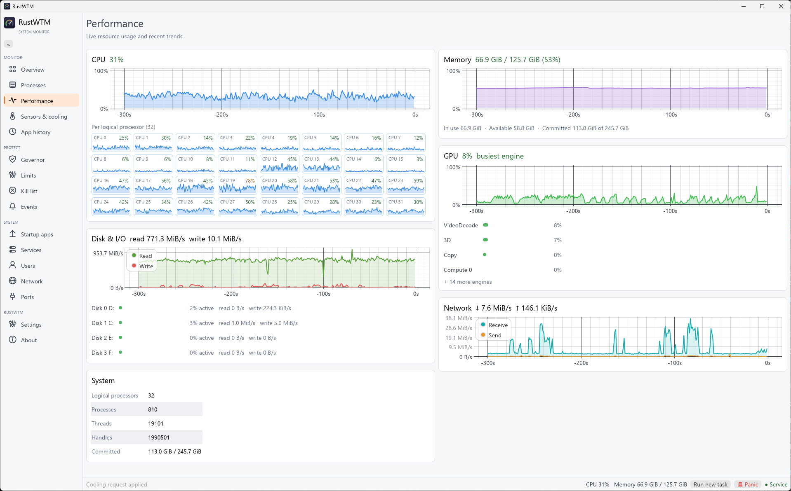

<p align="center">
  
</p>

<h1 align="center">RustWTM</h1>

<p align="center">
  <b>The Windows task manager that keeps your PC responsive.</b><br>
  Built in Rust by <a href="https://github.com/ersinkoc">Ersin KOÇ</a>.
</p>

A Windows task manager written in Rust, with a background governor that keeps
the machine responsive: it throttles, caps, suspends or terminates processes
that overload the CPU, gives apps CPU and memory budgets, frees RAM under
pressure, never slows down the app you are using, and learns from long-term
usage history.

[](https://github.com/ersinkoc/RustWTM/actions/workflows/ci.yml)
[](LICENSE)

> **Status:** early release (0.15). Sensors and cooling controls are available
> through the optional hardware provider. Device support varies; physical fan
> writes still require validation on each supported hardware configuration.
> Enforcement is **off by default** (dry-run); review the event log first.



## Features

**Task manager (GUI `rustwtm`, CLI `wtm`)**

- Overview start page: load at a glance, one-click protection on/off and
  protection levels, the busiest apps with quick actions.

- Processes: list, tree or Apps view (one row per app, acting on all of its
  processes), program icons, search (Ctrl+F), sort by any column, choose columns,
  details panel (path, command line, user, priority, affinity, efficiency
  mode, uptime, I/O), open file location.
- Pause process-list updates (F6) to inspect a stable snapshot while monitoring
  and protection continue. Quick filters for high CPU (5%+), high memory
  (512 MiB+) and managed processes combine with name, PID, path and command-line
  search, with processes started in the last N minutes, disk- or GPU-active
  processes, and user apps versus services. Wide tables scroll horizontally; the details panel scrolls and closes.
- Monitoring data shows its last receipt age on every page. Sampling failures
  and delayed updates display a warning while retaining the last values.
- **Reserved for RustWTM**: when the CPU is pinned, a rescue core is kept free
  for RustWTM and Windows by moving other programs off it until the load drops.
  The service and the window keep memory resident and run ahead of ordinary
  apps, so RustWTM stays usable on an overloaded machine. See
  [`[reserve]`](docs/configuration.md#reserve).
- Actions: end task, end process tree, suspend / resume, priority, CPU
  affinity, efficiency mode (EcoQoS), hard CPU cap and memory cap (job objects).
- Performance graphs (CPU with every logical processor, memory, GPU, network,
  disk I/O), App history, Startup apps,
  Users, Services (start / stop / startup type), Network connections, Events;
  every list sorts by any column.
- **Why it hangs, why it won't end**: programs whose window does not respond
  are marked *Not responding* (with a quick filter and an Overview warning);
  *Analyze wait chain* shows what their blocked threads wait for, across
  processes, and spots deadlocks. *Why won't it end?* explains a process that
  refuses to go: Windows protection, a security or anti-cheat driver that
  withholds the right, or other programs still holding it open.
- **Modules**: the DLLs a process loaded and who signed each (offline
  Authenticode and catalog check); unsigned and invalid ones first.
- **Network per program**: bytes received and sent per process (ETW, through
  the service or as administrator), a *Network* column and the busiest
  programs in the Network tab; *Close* resets an IPv4 TCP connection, and
  *Block network access* cuts a program off with two Windows Firewall rules
  (undo with *Unblock* in the Network tab).
- **Game mode**: while a full-screen app is in front, busy background apps get
  below-normal priority and efficiency mode (optionally the High performance
  power plan), all rolled back when it ends. See [`[game_mode]`](docs/configuration.md#game_mode).
- **Leak detection**: steady growth of memory, handles or threads in the app
  history is reported as a leak suspect.
- **Memory dumps from a clone**: the process is snapshotted (copy-on-write) and
  dumped from the snapshot, so it is frozen for milliseconds, not the whole
  write. The sign-in secrets processes (lsass, LsaIso) are never dumped.
- **AI assistants (MCP)**: `wtm mcp` is a Model Context Protocol server on
  standard input/output, so Claude Desktop, Claude Code and other MCP clients
  can ask what this PC is doing. Read-only unless started with
  `--allow-control`; nothing listens on the network.
- **Disks**: every drive with its free space, live activity per physical disk
  and the processes reading and writing the most. *Analyze* any drive or folder
  to see what takes up the space: a folder tree with sizes and shares, the 200
  largest files and the space per file type, each with *Show in Explorer*. The
  scan runs on a few background-priority threads (a 2 TB, 6 million file system
  drive took about a minute) and never follows junctions or symbolic links.
  *Files being read and written* lists, per program, the files moving the most
  disk bytes right now (a kernel trace that runs only while the tab is open,
  through the service or as administrator).
- Update notice with one-click update: the new installer is downloaded,
  checked against its published SHA-256 and installed; RustWTM restarts
  by itself.
- Run new task (optionally as administrator) and one-click restart as
  administrator; the window remembers its size, tab, columns and sorts.
- GUI and desktop notifications in English, Türkçe, Deutsch, Français and
  Español, with immediate language selection and a saved per-user preference.
  The first launch follows the Windows UI language. See [language support](docs/localization.md).
- Settings: edit the service's configuration with live validation and a
  one-click switch between dry-run and enforcing.
- **Overload alert**: when the CPU stays above 90%, RustWTM pops up over all
  windows with the busiest apps and one-click fixes (calm them all down,
  efficiency mode, limit to one core, pause, end) before the PC becomes
  unusable.
- Tray icon with a live CPU bar, desktop notifications; keeps running in the
  tray and starts there at sign-in (switchable in Settings).

**Governor service (`wtm-service`)**

- **CPU governor**: when the whole system stays above a threshold, the top
  consumers are escalated step by step (lower priority → efficiency mode →
  hard CPU cap) and rolled back once the system recovers.
- **Memory guard**: when RAM stays above 90%, the biggest background apps
  release their working sets (nothing is closed or lost).
- **The app you use stays fast**: the foreground app and its child processes
  are never throttled (`protect_foreground`).
- **Rules**: match processes by name or path (wildcards), optionally require a
  sustained condition (`cpu_above`, `memory_above_mb`, `gpu_above`), then apply actions —
  including `kill`. Unconditional rules react within ~250 ms of a process
  starting.
- **App limits**: give an app a CPU and/or memory budget (`node.exe`: 2 cores;
  `zen.exe`: 8 GB per instance) shared by all of its processes and their
  children. Edit them in the **Limits** tab or with `wtm app-limit`.
- **Kill list and panic button**: programs that may be ended, matched by
  name and command line (`node.exe` running `vitest` only). The service ends
  one that keeps eating CPU and does not recover; the panic button
  (Ctrl+Shift+K, `wtm panic --yes`) ends the whole list at once.
- **Ports**: every listening port with the program behind it, who can reach
  it (this PC only / all networks) and how many clients are connected; the
  usual ports of ~75 developer tools and servers (Vite, Next.js, PostgreSQL,
  Redis, Docker, Ollama, …) with their state; watched ports of your own;
  *Free a port* ends whatever keeps it busy (`wtm ports`,
  `wtm free-port 3000 --yes`). Windows' own ports and service hosts are left
  alone, and Docker / WSL relays come with a warning.
- **Swarm warning**: hundreds of copies of one program (a script that keeps
  starting `powershell.exe` and never waits for it) are reported with who
  started them; Overview ends them all, or only the orphaned ones, in one
  click.
- **Telegram bot**: status, busiest processes, ports, services and alerts on
  your phone; end (after a confirming tap), suspend and resume processes,
  free a port or press the panic button from anywhere. Only the chat IDs you
  allow can use it; set it up in Settings → Telegram.
- **Blocking**: programs on the `block` list are prevented from starting at
  all (Image File Execution Options), with a notification to the user.
- **Long-term insights**: per-minute, per-app usage is recorded to SQLite.
  Apps with chronically high CPU or steadily growing memory (linear trend with
  R² fit) are flagged, reported, and optionally acted on.
- **Safe by design**: dry-run by default; core Windows processes, critical
  processes and RustWTM itself are never touched; every source (governor,
  rules, insights, manual) is tracked separately and everything is rolled back
  when the service stops.

**Sensors & cooling** shows device temperatures, RPM, power, voltage and clocks,
with min/max and recent samples. Supported channels offer manual duty, editable
curves and Quiet/Balanced/Performance presets. Applying software control requires
an elevated GUI, the matching service and enforcing mode. Saved profiles are
drafts; startup keeps hardware automatic control. See [hardware setup and
validation limits](docs/hardware.md).

Hybrid CPU discovery, P/E/LP-E process selection and shared Windows frequency
limits are available in 0.13.1. See [CPU topology and
power controls](docs/cpu-controls.md) for commands, scope and rollback behavior.
Shared power-plan limits persist until you restore the saved settings.

## Requirements

- Windows 10 1809 or later / Windows 11, 64-bit.
- Administrator rights to install the service and to control processes of
  other users and services.

## Install

### One-liner (latest release)

From an **elevated** PowerShell:

```powershell
irm https://raw.githubusercontent.com/ersinkoc/RustWTM/main/scripts/install.ps1 | iex
```

This downloads the latest release, verifies its SHA-256 checksum, installs to
`C:\Program Files\RustWTM`, adds it to `PATH`, creates a Start Menu shortcut,
and installs and starts the `RustWTM` service (in dry-run mode).

Options (download the script first to pass them):

```powershell
.\install.ps1 -Version v0.1.0          # a specific release
.\install.ps1 -NoService               # GUI and CLI only
.\install.ps1 -FromSource .            # build this checkout instead of downloading
.\install.ps1 -DownloadOnly -InstallDir D:\Tools\RustWTM   # portable, no admin needed
```

### MSI package

Each release also ships `RustWTM-<version>-x64.msi` (with a `.sha256`). It
installs to `C:\Program Files\RustWTM`, registers and starts the service
(with automatic restart on failure), adds the folder to `PATH` and creates a
Start Menu shortcut. Uninstall it from *Settings → Apps*; configuration and
history in `%ProgramData%\RustWTM` are kept.

```powershell
msiexec /i RustWTM-0.22.0-x64.msi            # interactive
msiexec /i RustWTM-0.22.0-x64.msi /qn        # silent
```

### Uninstall

```powershell
& "$env:ProgramFiles\RustWTM\uninstall.ps1"            # keeps config and history
& "$env:ProgramFiles\RustWTM\uninstall.ps1" -RemoveData
```

### From source

```powershell
git clone https://github.com/ersinkoc/RustWTM
cd RustWTM
cargo build --release      # the toolchain is pinned in rust-toolchain.toml
./scripts/build-hardware.ps1 -OutputDir target/release/hardware
```

Binaries land in `target\release\`: `rustwtm.exe` (GUI), `wtm.exe` (CLI),
`wtm-service.exe` (service).
The optional provider build requires the .NET 8 SDK or newer. Release packages
include a self-contained provider; users do not need to install .NET separately.

## Usage

### GUI

Start **RustWTM** from the Start Menu. Right-click a process for actions.
The badge in the top-right corner shows whether the GUI is connected to the
service; run it as administrator to send commands through the service.

### CLI

```text
wtm list --sort mem -n 20          one-shot listing
wtm list --json                    the same as JSON (also `info`, `ports`)
wtm sensors --json                local read-only hardware readings
wtm cores                         logical processors and relative P/E tiers
wtm affinity 1234 --ecores         use the regular efficient tier
wtm power show                    shared Windows frequency policy (read-only)
wtm top                            live view (c/m/d/p/n to sort, q to quit)
wtm info chrome                    details of every chrome.exe
wtm kill 1234 --tree               end a process and its descendants
wtm suspend notepad / wtm resume notepad
wtm trim chrome                    free RAM held by every chrome.exe
wtm dump 1234                      full memory dump file, for debugging
wtm priority 1234 below-normal
wtm affinity 1234 0-3,6
wtm eco 1234 on
wtm limit 1234 --cpu 10 --memory 2G   hard caps (Ctrl+C lifts them)
wtm history --hours 24             long-term per-app usage and findings
wtm app-limit set node.exe --cores 2 --memory 8G   persistent app budget
wtm app-limit list                 configured app limits and their usage
wtm ports --known                  listening ports of dev tools and servers
wtm free-port 3000 --yes           end whatever keeps port 3000 busy
wtm config show                    the service's configuration
wtm config check my.toml           validate a file
wtm config apply my.toml           validate and apply it (elevated)
wtm mcp [--allow-control]          MCP server for AI assistants (stdio)
```

To let an MCP client use it, add RustWTM to its server list, e.g. in Claude
Desktop's `claude_desktop_config.json`:

```json
{ "mcpServers": { "rustwtm": { "command": "C:\\Program Files\\RustWTM\\wtm.exe", "args": ["mcp"] } } }
```

or with Claude Code: `claude mcp add rustwtm -- "C:\Program Files\RustWTM\wtm.exe" mcp`.
Tools: `system_overview`, `list_processes`, `process_details`,
`why_not_responding`, `why_wont_it_end`, `network_connections`, `drives`,
`recent_events`; with `--allow-control` also `end_process`, `suspend_process`,
`resume_process`, `set_priority` and `efficiency_mode`, which require the
`create_time` that `list_processes` reports, so a PID reused meanwhile is
refused.

Targets are PIDs or image names (`.exe` optional, case-insensitive).

### Service

```text
wtm-service install | uninstall | start | stop
wtm-service cleanup                remove RustWTM's program blocks and firewall rules
wtm-service console --data-dir .\data    run the engine in the foreground
```

The service runs as SYSTEM, so `install` refuses a folder that others than
administrators can change (or that a folder above lets them move): install
from Program Files with `install.ps1` or the MSI. To install a development
build from its build folder, set `RUSTWTM_ALLOW_ANY_INSTALL_DIR=1` first, on
a development machine only.

## Configuration

The service reads `%ProgramData%\RustWTM\config.toml` (created with commented
defaults on first start) and reloads it automatically when it changes. Edit it
in the GUI's **Settings** tab or with `wtm config apply` (both validate first
and need an elevated client), or by hand.

```toml
dry_run = true            # log decisions only; set to false to enforce
block = ["xmrig.exe"]     # never starts at all

[governor]
high_cpu_percent = 90.0   # act when the system stays above this...
sustain_secs = 5          # ...for this long
recover_cpu_percent = 70.0
ladder = [{ priority = "below_normal" }, "eco_qos", { cpu_cap_relative = 0.5 }]

[insights]
window_hours = 24
chronic_cpu_percent = 10.0
chronic_actions = [{ priority = "below_normal" }, "eco_qos"]
growth_mb_per_hour = 200.0
growth_actions = []        # report only

[[rule]]
name = "Kill miner variants"
match = { name = "xmrig*.exe" }
actions = ["kill"]
```

See [docs/configuration.md](docs/configuration.md) for every option.

> CPU percentages are a share of the **whole machine** (all logical
> processors), the same scale the process list uses.

## Security model

- The service runs as LocalSystem. Its data directory is restricted to
  SYSTEM and Administrators (users can read).
- The GUI/CLI talk to it over the local named pipe `\\.\pipe\RustWTM`
  (remote clients rejected). Anyone can read status; **control requests require
  an elevated administrator**. Detail queries run with the caller's own rights.
- Clients verify that the pipe is served by the installed `RustWTM` service.
- The Telegram bot token lives in `telegram.toml`, readable only by SYSTEM and
  Administrators. The bot answers only the chat IDs on its list (Telegram
  vouches for the sender), asks before ending anything, never ends protected
  processes, and can be limited to reports.

Report vulnerabilities as described in [SECURITY.md](SECURITY.md).

## Architecture

| Crate | Purpose |
|---|---|
| `wtm-sys` | Safe wrappers over Win32 / NT APIs — the only crate with `unsafe` |
| `wtm-core` | Process model, sampler, process tree, control actions, startup apps |
| `wtm-policy` | Config, governor, rule engine, long-term insights (pure logic) |
| `wtm-ipc` | Named-pipe protocol and client |
| `wtm-service` | Windows service: engine loop, executor, history, IPC server |
| `wtm-gui` | egui front-end (`rustwtm.exe`) |
| `wtm-cli` | Command-line interface (`wtm.exe`) |

## Development

```powershell
cargo fmt --all
cargo clippy --workspace --all-targets -- -D warnings
cargo test --workspace
```

See [CONTRIBUTING.md](CONTRIBUTING.md) and the roadmap in [PLAN.md](PLAN.md).
The [0.13.0 system review](docs/0.13.0-review.md) covers the current architecture,
validation boundaries and the implemented sensors and cooling work.
The [0.22.0 release review](docs/0.22.0-review.md) records the latest reproduced
defects, regression evidence, release checks and remaining hardware boundaries.

## License

[MIT](LICENSE)
