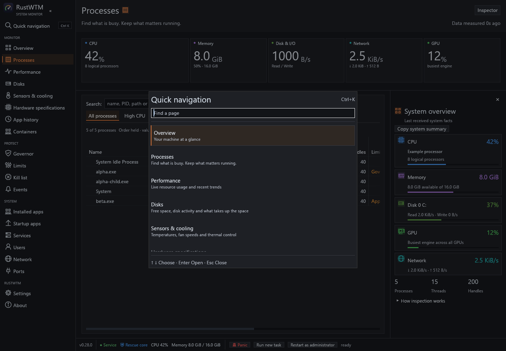

# Desktop controls and hardware identity

## Quick navigation

Use the search entry beneath the sidebar brand, or Ctrl+K, to find a page by
its translated name, English name or translated description. The dialog shows
descriptive results; arrows select, Enter opens and Escape dismisses. Input is
limited to 128 characters and searches only the fixed page catalog. It does not
execute actions or discard page drafts. Existing confirmations block it;
Ctrl+Shift+K retains the panic confirmation.

RAM identities also include the reported SMBIOS memory generation and WMI module
form factor. The two code namespaces are decoded separately. Unknown codes do
not imply a memory generation or physical form. These details share the existing
bounded, once-per-window inventory, including its unavailable states.

## Shared layout

Every page has a single 12-pixel horizontal / 8-pixel vertical gutter.
Sections are separated by 8 pixels; cards use 10-pixel horizontal / 8-pixel
vertical internal padding, without an additional outer margin. Resource grids
keep 4-pixel gaps.
Table cells remain joined, with internal padding and square corners. A sortable
header selects, highlights and responds across its full cell, including totals.

Right-click a sortable table header for sort direction and independent row and
column separators. Process headers also offer grouped column visibility,
width fitting and saved presentation controls. Right-click data items to copy
their values or use the available navigation and actions. Disk activity exposes
file-path copying and **Show in Processes** for a live owner. A remaining file
activity record can still copy its PID after its process exits.

Startup status switches send the existing startup command directly. The displayed
state follows the next backend refresh, including failures; the view does not
pretend that a failed operation succeeded. The selected-entry toolbar remains
available. Services combine search with All services, Running and Stopped filters.
Startup combines name, command-line, account-scope and registration-source search
with All apps, Enabled and Disabled filters. Ctrl+F focuses search, Escape clears
its text and Clear filters resets both text and status after an empty result.
The selected-entry action toolbar follows the visible rows and current backend
state. Counts show the visible share of registered entries while filtering.
Service filters describe runtime state and do not classify a publisher from a name
or installation path.

Service CPU and memory percentage thresholds use sliders with editable numeric
values. Thresholds and durations use aligned rows with associated field labels.
Existing validation, ranges, persistence and privilege checks still apply.
The sidebar toggle belongs to the brand header. The footer separates connection
and current resource information from actions and inline operation messages.

## Hardware inventory

The process workspace system inspector embeds CPU, RAM module, disk and graphics
adapter identities directly in the corresponding live resource cards. Repeated
RAM modules are grouped with their module count; physical disks match their CIM
index, never their enumeration order. Motherboard identity has its own system row.
There is no separate Hardware details list beneath the inspector. Overview also offers Hardware details.

Copy system summary exports this hardware inventory: model/manufacturer, CPU core
counts, motherboard revision, individual RAM part numbers/capacities/configured
clocks/slots, physical disk models/capacities/interfaces and GPU driver details.
It does not export live utilization, process counts or transient memory use.
The action is disabled while inventory loads or if no usable inventory exists;
partial category failures remain explicitly unavailable. Copying does not require
a live monitoring snapshot.

Names, manufacturers, part numbers, capacities, configured memory clocks and
reported interfaces come from local CIM classes. Disk interfaces are displayed
as reported, without inferring NVMe from a generic SCSI interface. GPU models are
separate from the aggregate busiest-engine utilization counter.

A hidden Windows PowerShell process reads explicitly selected properties once
per window, outside the UI and sampling threads. No serial numbers are queried.
The executable comes from Windows' system directory and must pass the existing
administrator-controlled-path check. Collection has a 25-second deadline, a
512-KiB reply cap and bounded category/field counts. Category failures preserve
other results. Missing details show an unavailable state. Closing the window
does not wait for inventory; the bounded worker cleans up its child process.

Memory capacities use bytes, while ConfiguredClockSpeed is displayed in MHz,
as documented by [Microsoft's physical memory class](https://learn.microsoft.com/en-us/windows/win32/cimwin32prov/win32-physicalmemory).

Tests use synthetic inventory and command capture; they never change startup
entries or services. The opt-in local inventory smoke only reads hardware.

## Quick setup

On first use and once after each version change, a five-step welcome flow offers
language, theme, scale, density, process layout and inspector, table separators,
CPU/memory tray readouts, close-to-tray behavior and refresh/update preferences.
It begins with the current settings. Next and Back retain draft choices; only
Apply and finish commits them. Skip setup, Escape or clicking outside dismisses
the flow without changing preferences, and marks that version as seen.

The final review groups language, appearance, process workspace and window
behavior into compact sections. Expand Details to inspect individual switches.
Each Edit button opens its section directly; Review your settings returns to
the summary with draft changes intact. Larger windows show all four sections
together, and smaller windows scroll while keeping navigation available.

Hidden launches defer the flow until the window is brought to the foreground.
Completion and skipping request an immediate normal preferences save. Existing
settings without a setup marker receive the flow once. Reopen it with Quick
setup under Settings, in Interface activity and shortcuts. Language-save failures
keep the draft open for retry, with a persistent warning above the scrolling
content. The warning shares the content height budget so navigation stays in
place. Escape closes an open language picker before dismissing quick setup.
Native startup, service and policy settings are
configured separately.

## Visual layout

Saved native window dimensions are validated after restoration. Sizes below
820×500 are raised to the supported minimum; valid geometry and window flags
are retained. Non-finite dimensions use the default 1240×780 size. During a
zero-size native creation or minimization frame, page layout waits for a usable
client area while visibility and close handling continue normally.

Pages open directly into their controls and content. Settings tabs, cards and
the configuration editor span the available workspace width. Sampling age and
the process Inspector menu are available in the footer. Focused performance pages
allocate more height to charts; processor tiles use adaptive columns and small
gutters. Compact windows retain scrolling and a wrapping footer.

Verification before the 0.28.0 version bump: 246 GUI tests passed with three explicit opt-outs (benchmark,
asset regeneration and hardware smoke). The read-only hardware smoke was run
separately and passed on the local machine. Clippy covers all targets/features
with warnings denied. Updated visual previews cover both themes and both widths.
