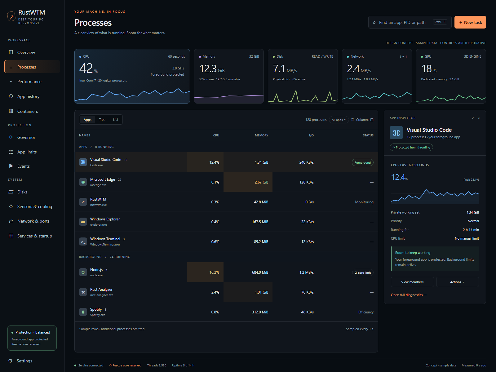

# RustWTM desktop experience plan

Status: roadmap with an initial visual subset implemented in source; see below.
Reviewed: 2026-11-09 against workspace version 0.26.2.

The [2026-11-10 capability review](desktop-gap-review-2026-11-10.md) updates
the feature-by-feature gaps and implementation order against 0.27.0.

## First visual implementation

The first implementation adds the shared system resource strip to Processes,
including keyboard-accessible navigation to the existing Performance views and
a saved visibility preference. The inspector now emphasizes process identity,
CPU/private memory and existing history, with primary actions near the top.
Dark surfaces and selection colours are coordinated across the GUI. Narrow
process workspaces use a quick-filter menu and retain advanced filters under
More filters. No new sampler, service privilege or enforcement behaviour is
introduced.

This completes a subset of M1 and inspector presentation from M2b. M2a's
stable inspection is now implemented: pointer/menu/modal holds retain live
values and identity-based ordering, including cached rows, trees and Apps.
M2b's column profiles, searchable selection, explicit ordering and persistence
are also implemented; see the [column layout guide](process-columns.md).
M3's initial timeline interactions are implemented: shared timestamp cursor,
covered ranges, pinning, zoom/reset, keyboard stepping and event markers with
explicit sampling gaps; see the [timeline guide](performance-timeline.md).
Focused resource views, CPU tier filtering and GPU engine-type search are also
implemented; see the [resource guide](performance-resources.md).
The process workspace now also has a saved adaptive/pinned/hidden inspector,
system facts without selection, two-level total/sort headers and calmer row
styling; see [workspace behavior](process-workspace.md).
M1's density/motion controls, M2b's pinned-name/group inspector, M3's physical
device selection/history and later feature milestones remain pending. The original HTML
concept remains a design proposal; generated egui previews are separate.

The [live inspection guide](process-inspection.md) describes M2a's ordering,
membership, identity and pause semantics.

Current source previews: [dark workspace](../screenshots/processes.png),
[light workspace](../screenshots/processes-light.png) and
[compact workspace](../screenshots/processes-compact.png). They use synthetic
measurements, not this machine's workload.

See the [implementation and validation record](desktop-review-2026-11-09.md)
for the exact delivered subset and remaining boundaries.

## Outcome

Make RustWTM easier to read, inspect and diagnose during everyday use while
preserving its governor, rescue core, process protections and low overhead.
Keep the existing Rust/egui architecture, orange brand accent and resource
palette. Build original components within the current application.

This plan extends the [product roadmap](product-roadmap.md). Distribution,
signing, upgrade durability and physical cooling certification retain their
existing gates. UI work can proceed independently; it does not complete those
gates. The baseline below is a source and existing-preview review, not a live
certification of the installed application or hosted CI.

## Current geometry and settings

The source now follows the requested square layout: zero corner radius,
outer margins between adjoining surfaces, readable internal padding and small
control gaps, with explicit border and separator lines in both themes. Content
padding is separate from the spacing between panels.
Appearance, Process workspace and Charts and history settings expose persisted
window preferences; see [the settings guide](display-preferences.md).

## Verified baseline and remaining gaps

| Area | Present in this checkout | Work still needed |
| --- | --- | --- |
| Visual foundation | Light/dark/system themes, Segoe UI, vector navigation icons, collapsible sidebar, resource colours, heat cells, gauges and sparklines | Consistent dense layout, shared resource strip, explicit density and motion preferences |
| Process browsing | List/tree/Apps, icons, filters, column visibility, resizable table, horizontal scrolling, selected-process details | Stable row order during inspection, column ordering/presets, pinned name column, richer empty/group details |
| Safe selection | Process references include PID and creation time; menus/confirmations have identity regressions | Preserve these invariants through every new table/panel interaction |
| History | SQLite per-minute app rows; 1/6/24-hour and 7/30-day GUI windows; findings and selected-app series | Persisted system/device timeline and selecting a historical minute to explain its busiest apps |
| Recent charts | Timestamped `SystemPoint`, bounded recent samples, Performance and process plots | Shared range/cursor/zoom, event correlation, explicit gaps and coverage |
| File diagnosis | File I/O tracing, disk usage scan, wait chains, end-failure diagnosis and modules | Find the processes preventing a file/folder operation, including a drag/drop entry point |
| Hardware | CPU topology and tiers, GPU engines, physical-disk activity, provider sensors/cooling | Focused device pages, battery overview and read-only disk health/SMART presentation |
| Service and integration | Local fallback, service connection modes, startup/elevation settings, tray, Task Manager replacement, new task and updater | Guided first use, clearer capability explanations, configurable show/hide hotkey and visibility-aware refresh |
| Services/startup/network | Sortable views, existing controls, connection close and firewall controls | Local notes/pins, exact endpoint filters, navigation from a process to its services/connections |

### Implementation anchors

- GUI shell, preferences, details and Performance: `crates/wtm-gui/src/app.rs`.
- Shared colours, cards, gauges and sparklines: `crates/wtm-gui/src/theme.rs`;
  navigation drawing: `crates/wtm-gui/src/navigation.rs`.
- Process filtering, row cache, grouping and columns:
  `crates/wtm-gui/src/processes.rs`.
- App history, services, startup and connections: `crates/wtm-gui/src/views.rs`.
- Background collection and command dispatch: `crates/wtm-gui/src/backend.rs`.
- System/process model: `crates/wtm-core/src/model.rs`; recent samples and wire
  requests: `crates/wtm-ipc/src/lib.rs`.
- SQLite recording/queries: `crates/wtm-service/src/history.rs`; request
  authorization and history query windows: `crates/wtm-service/src/ipc_server.rs`.
- Existing native device collection: `crates/wtm-sys/src/disk.rs`;
  hardware capabilities: `crates/wtm-core/src/hardware.rs`.

These are extension points, not instructions to grow `app.rs` further. Extract
new focused modules as each milestone lands. New native API calls belong in
`wtm-sys`; models/aggregation belong in core, service or policy as appropriate.

## Visual and interaction direction

### Visual identity and review artifact

The visual redesign is a primary deliverable, not incidental spacing polish.
The [desktop concept](desktop-concept.html) is a standalone static mockup with
synthetic data and illustrative controls. Open it locally in a browser; it
does not connect to the service or perform actions. It is a visual proposal,
not an egui implementation or a report of this computer's measurements.



The wide concept was rendered at 1600x1200 and the compact layout inspected
at 800x1000 in headless Chromium. These checks cover the HTML proposal only;
localized egui, light-theme and DPI acceptance remain implementation gates.

Direction: a precise desktop workspace with deep blue-grey surfaces, warm
orange navigation/action accents and a stronger hierarchy between machine
status, resource measurements and individual apps. Keep the expanded sidebar
as the default identity; do not turn the shell into a row of generic tabs.

The key visual changes are:

1. A larger CPU card anchors an asymmetric resource strip. The other four
   resources use quieter typography and compact charts. Use fewer large rings
   on data-dense pages; preserve them on Overview.
2. A selected application receives a dedicated inspector with a clear app
   identity, measured history, concise facts and an explanation of protection
   status. The explanation must follow real capabilities/state in production.
3. Protection and rescue-core status remain part of the product's visual
   identity, with a compact sidebar/status presentation. Resource heat cells
   reveal pressure without colouring whole rows or competing with selection.
4. Separate navigation, table toolbar and diagnostic actions by visual weight.
   Reduce card nesting; align header, charts, table and inspector to one grid.

Proposed dark tokens are expressed in OKLCH for design review: base
`oklch(.155 .014 255)`, surface `oklch(.195 .015 255)`, raised surface
`oklch(.23 .016 255)`, border `oklch(.30 .016 255)`, main text
`oklch(.94 .008 255)` and secondary text `oklch(.71 .025 255)`.
The concept uses a brighter orange for primary controls; reconcile that with
the existing brand orange through explicit theme tokens rather than replacing
resource colours. Convert approved tokens to egui sRGB values centrally.

Use installed Segoe UI Variable/Segoe UI for body and display text, with a
monospaced numeric fallback. No downloaded font dependency. Target a 29-point
page title, 34–43-point resource values, 12–14-point table text and readable
11–12-point metadata. The mockup's smaller overline labels are illustrative;
production must validate readable scaling and text contrast. Check contrast
for both themes before approval; no WCAG certification is claimed here.

Produce actual egui dark/light, wide/compact previews before landing M1.
Review typography, icon consistency, selected/hover/focus states, missing data
and long Turkish/German text. Static mockup navigation merges some labels only
for composition; the production navigation must retain every existing page
and entry point. Replace mockup text glyphs with existing vector icon drawing.

The process page should communicate system pressure before the user reads any
row, keep the selected target visible, and put advanced diagnostics one action
away. Overview remains the home for protection and workload summaries.

```text
Expanded or compact sidebar | Page title       Search       Page actions
                           | CPU | Memory | Disk | Network | GPU
                           | View / filters / columns / inspection state
                           | Sticky name + resource table | Inspector
                           |                              | or machine summary
                           | Service / rights / protection / data age
```

- Keep existing resource hues: CPU blue, memory purple, GPU green, receive
  teal, transmit amber, disk read green and write red. Orange identifies
  navigation and brand actions. Warning/error states retain text or icons so
  that colour alone never carries meaning.
- Use a quiet surface hierarchy: page background, section surface, selected
  row. Consolidate redundant card borders and large gaps on dense pages.
  Keep the existing Overview gauges; compact pages use numbers and sparklines.
- Use stable numeric widths and tabular digits where the font supports them;
  reserve space for common maximum values so readings do not move columns.
  Friendly app names are primary; executable names and paths are secondary.
- Separate disk I/O, file/device I/O and network labels. Never rename the
  existing combined I/O rate to physical disk throughput.
- Use comfortable density by default, plus a compact preset. Target 28-point
  and 24-point rows respectively, subject to font/DPI review. Maintain clear
  focus rings and full tooltips for shortened labels.
- At wide widths show table and inspector together. At compact widths make
  the inspector a dedicated detail surface with Back; the selected process
  remains identifiable. Resource cards wrap or collapse to compact values
  instead of squeezing five illegible charts into a row.
- Keep native window decoration and snap behaviour. Mica/system-accent support
  is optional polish after readability and performance are established; it
  must have an opaque fallback on unsupported systems or reduced transparency.
- Animate only short user-triggered transitions when enabled. Chart motion
  must respect real sample times; no artificial values or permanent 60 Hz
  repaint loop. Reduced motion disables transitions without changing data.

## Milestones

Effort is relative: S is a contained GUI change, M spans a view and model,
L spans native collection or persistence/IPC. These are planning estimates,
not delivery dates. Each milestone should be reviewable and releasable on its
own after its acceptance gates pass.

### M1 — Shared resource strip and consistent page shell (P1, M)

Add a reusable `resource_strip.rs` using current snapshots and bounded recent
histories. Start on Processes; let settings control its visibility on other
monitoring pages. Do not duplicate the full strip above Overview's gauges.

Each resource shows its current value, unit, source/freshness tooltip and a
small history. Clicking selects the relevant existing Performance focus or
Disks page. CPU frequency/temperature and GPU temperature/power appear only
when a supported provider supplies them; missing values display an explicit
unavailable state rather than a fabricated zero. Memory uses system physical
usage, not a sum of process working sets.

Extract a shared page header and status treatment. Preserve the always-visible
service/rights, protection and stale-data states; lower-priority counters may
collapse when space is limited. This milestone adds density and reduced-motion
preferences with defaults for old saved state.

Acceptance: all five languages, both themes, 800x600 and 1440x1000 fixtures,
100/125/150/200% DPI; no clipped values or inaccessible actions. Card navigation
selects the correct target; stale cards remain visibly stale. Render the new
Processes fixture through the existing visual-review mechanism.

### M2 — Stable inspection and configurable process tables (P1, L)

Split into M2a stable inspection and M2b column/inspector improvements.

M2a keeps row order while the pointer is inspecting the table or a menu/modal
is open, while live values continue updating. Store identities rather than
snapshot indices; reconcile exits/new arrivals without changing an open
action's target. Show why sorting is held and resume deterministically.
Existing F6 remains a separate frozen-snapshot mode. Selection, keyboard
navigation, explicit sort changes and filter changes have defined precedence.

M2b adds searchable column selection, reorder controls with keyboard
alternatives to dragging, reset and saved presets: Basic, CPU, Memory, I/O,
Network and Diagnostics. Freeze Name during horizontal scrolling. Persist
column IDs rather than translated text or numeric enum positions, and ignore
unknown IDs safely on downgrade.

Add inspector modes: automatic, always shown and hidden, with saved width.
Without selection, show a concise machine summary and capability status.
Selecting an app group shows combined measurements, members and group-scoped
actions, with the same confirmation and identity checks as existing actions.
Offer optional Apps/Background/Windows categories only when sorting by name;
numeric resource sorts remain global. Classification must not imply safety.

Acceptance: sorting changes, filtering, row insertion, process exit, PID reuse,
keyboard selection, open confirmation and snapshot pause cannot redirect an
action. Persisted columns survive theme/language changes and old preferences.
Cross-process shared memory is not presented as unique physical usage. Wide
and compact inspector layouts keep primary actions visible.

### M3 — Interactive charts and focused device views (P1, L)

Source progress: the initial bounded timeline interaction is implemented and
locally validated; see [usage, evidence and remaining scope](performance-timeline.md).
Focused resource presentation, CPU tier filters and GPU engine-type search
are implemented; see [resource views and remaining scope](performance-resources.md).
This milestone remains open for physical device selection/history and the
other chart capabilities described below.

Introduce shared chart state in `charts.rs`: real timestamps, a common cursor,
range selection, zoom/reset, keyboard stepping and a visible Live/Inspecting
state. Initially expose only ranges covered by memory; M4 enables longer
persistent ranges. Requests must never imply an unrecorded hour is available.

For Performance, retain the existing overview and add focused CPU, memory,
physical disk, adapter and GPU pages. CPU allows P/E/LP-E filters; GPUs have
engine selection and a bounded adaptive grid. Persist device selection using
stable identity with a fallback when a device disappears. GPU engine shares,
overall GPU usage and VRAM must retain their distinct definitions.

Use readable rate axes, separate receive/transmit legends and optional
bits/bytes network units. CPU/memory charts keep fixed percentage bounds;
rate axes use hysteresis to prevent constant rescaling. Missing/stale samples
break lines; reconnecting does not insert zeroes. Optional smooth scrolling
changes the viewport only, not sample values.

Acceptance: deterministic timestamps, gaps, clock changes, pause/resume,
reconnect, zero activity, large values and device removal. Cursor matches the
same timestamp across charts. Controls work without a pointer. Existing
Overview and per-core tiles remain usable.

### M4 — Persistent system history and historical attribution (P1, L)

Extend the existing SQLite history instead of introducing a second recorder.
Keep current app rows and default 30-day app retention. Proposed system
retention is seven days of minute aggregates, configurable separately; longer
retention requires a measured storage budget. Keep per-core high-resolution
data in the bounded live ring initially.

Add a versioned `system_minute` table with interval start/end, sample count,
coverage, supported metrics, source/capability information, average and peak
usage and byte totals for supported rates. Use an additive, transactional
migration. Decide aggregation by metric explicitly: weight rates/percentages
by valid elapsed time, preserve peaks, and account for counter resets.

Add bounded read requests for a time window/resolution and top apps for a
selected minute, with explicit availability in replies. Postcard enum/model
changes require the repository's protocol-version/compatibility handling;
an older service must degrade to the existing recent/app-history surfaces.
SQLite work and chart downsampling run off the UI/sampler critical path.

Clicking a historical point answers “which apps were busy during this
minute?” using recorded app rows. It must never claim an exact historical
PID, executable path, command line or one-second spike from name-based
minute aggregates. Label legacy same-name apps as combined. Before recording
path-separated identities, define normalized-path identity, optional metadata
privacy and migration; do not silently reinterpret old rows.

Acceptance: upgrade from the present schema preserves records; repeated
flush/restart merges correctly; missing coverage, daylight-saving display,
clock reversal, pruning, busy/read-only database and interrupted migration
have bounded failure behaviour. Historical entries cannot issue actions on
present-day processes without selecting and verifying a live identity.

### M5 — File/folder ownership diagnosis (P1, L)

Add “Find file owners” from the toolbar and Disks, with browse, pasted path
and drag/drop. Query Restart Manager first for supported exact-file cases.
For folder trees and unresolved cases, offer an explicit deeper scan with
bounded traversal and handle inspection; explain partial results and scope.
Do not follow junctions or symbolic links recursively by default.

Native APIs live in a new `wtm-sys` wrapper. Potentially blocking handle-name
queries run in a dedicated helper with a deadline, not abandoned threads in
the GUI or service. Allow one investigation at a time, bounded result pages
and cancellation. Initial proposal: 10-second scan budget, 1,000 displayed
results and explicit truncation; validate these limits before expanding them.

Show owner PID/creation time, app, matched path, evidence source and access
status. Distinguish open-file ownership, current directory, loaded image and
observed I/O; none alone proves that a process blocks deletion. Never force
close foreign handles. Navigate to existing details/wait diagnosis and reuse
the established confirmed end-task action when the user requests it.

Use the caller's rights first. A privileged service request requires explicit
server-side authorization and the existing client verification rules; a
standard GUI must not gain new administrative controls implicitly.

Acceptance: a tiny helper holds one temporary file; cancellation, helper
timeout, missing/deleted paths, inaccessible owners, Unicode paths, process
exit and PID reuse are reproducible without pressure on host resources.
“No owners found” differs from “inspection incomplete/access denied”.

### M6 — Guided first use and capability explanations (P1, M)

Add a resumable welcome flow: language/appearance, monitoring vs protection,
service/elevation capabilities, and optional tray/startup preferences. Skip
leaves dry-run and existing settings intact. Show a review of actual proposed
changes before any control, startup or integration setting is applied.

Do not reinstall a service or enable Task Manager replacement by implication.
Reuse the current opt-in integration UI and safety checks. A capability panel
explains why ETW, file inspection, sensors or control is unavailable and links
to the relevant existing settings/help. Make help reopenable after first use.

Acceptance: cancel at every step, unavailable service, ordinary/elevated GUI,
older/newer protocol, save errors, and restart/resume. Each choice persists
only after successful save. All five translations land with the feature.

### M7 — Refresh policy, tray hotkey and keyboard help (P2, M)

Separate GUI painting, UI polling and service sampling. Proposed UI polling
presets are 0.5/1/2/5 seconds, clamped to supported service sampling; hidden
windows reduce polling and disable chart animation. Keep governor cadence,
history and alert detection independent of presentation preferences.

Add a configurable global show/hide hotkey with conflict detection and
unregistration at exit, plus a searchable keyboard-help dialog. Preserve
Ctrl+Shift+Esc Task Manager integration and Ctrl+Shift+K panic semantics;
do not take either shortcut for ordinary window toggling. Hotkeys must not
fire while being edited or trigger destructive actions from a text field.

Acceptance: hotkey collision, disabled hotkey, minimize/restore, session lock,
tray-only mode and reconnect. Prove hidden-mode savings using bounded
measurements of RustWTM itself, while protection/alerts continue correctly.

### M8 — Hardware information completeness (P2, L)

Add read-only battery percentage, AC/charging state and remaining-time estimate
when Windows reports them. Later expose design/full-charge capacity and wear
only where a reliable source exists. Desktop systems show a clear no-battery
state; unknown estimates never become zero minutes.

Add disk identity, media/interface, firmware, temperature and health/SMART
details through supported native/provider queries. Separate NVMe and ATA
attributes; preserve raw units and source. USB bridges, RAID and access denial
must show unsupported/partial states. Poll slow health metadata on demand or
at a low frequency; do not couple it to per-second disk activity sampling.

Acceptance: provider fixtures for supported/unsupported/partial devices,
disconnection, timeout and stale readings. Confirm supported hardware manually
with read-only queries. No driver installation or physical cooling write is
part of this milestone; existing physical certification remains separate.

### M9 — Personal organization and cross-page navigation (P2, M)

Add local notes/pins for services, startup entries and endpoint views, followed
by optional Overview card ordering/visibility. Stable keys must match the
object: service name, startup source plus entry identity, and a documented
endpoint identity rather than a transient row number or PID alone.

Add exact port/protocol/address filters and links from process details to
owned connections and hosted services. Keep pinned items separate from a
global CPU sort; pinning never changes action scope. Save per-user metadata
atomically with explicit remove/reset and bounded note lengths. Do not add
notes to privileged service configuration or diagnostic exports by default.

Acceptance: disappeared/recreated objects, duplicate display names, changed
ports, notes save failure, multiple instances, language change and reset.
Links reveal the target even when previous page filters would hide it.

### M10 — Shared incident timeline and support export (P2, L)

After M3/M4, correlate system samples, app aggregates, governor events and
sensor availability by timestamp. Add Docker events/history only after its
separate persistence and identity work in the product roadmap. Always show
timestamp resolution, coverage and source; correlation is evidence for
inspection, not proof of causation or authority to enable enforcement.

Add an explicit preview/export flow for version, capabilities, selected time
range and recent diagnostics. Exclude Telegram tokens, environment secrets,
private command lines, full paths, notes and container logs by default.
User-selected sensitive fields require clear preview. Bound output size and
perform export in the background. No automatic upload or support messaging.

Acceptance: redaction controls, canceled export, unavailable sources,
large-but-bounded fixture, partial timeline and file-write failure. Exported
timestamps and identities agree with the visible incident.

## Delivery sequence and dependencies

1. M1 establishes shared layout/state. M2a follows immediately for reliable
   inspection; M2b completes table/inspector usability.
2. M3 establishes chart state. M4 then provides persistent ranges/attribution.
3. M5 delivers file ownership diagnosis independently of history storage.
4. M6 uses the finalized capability language and appearance controls from M1.
5. M7 follows instrumentation; M8 and M9 follow their own native/state gates.
6. M10 consumes M3/M4 and existing events; container correlation additionally
   depends on the roadmap's Docker persistence work.

Recommended first delivery: M1 plus M2a. It improves the most frequently used
screen without a database migration, new privileges or hardware dependency.
Do not bundle M4/M5/M8 into that change. Review the shared strip before rolling
it out across every page.

## Cross-cutting contracts

- Never exhaust developer-host memory, address space, handles, threads, kernel
  pool or ETW sessions. Inject allocation/spawn/API failures through seams.
  No exhaustion proof runs on this machine; real exhaustion would require
  separate approval and a disposable VM under `CLAUDE.md`.
- Keep queues, native queries, history replies, points drawn and metadata
  caches bounded. Establish initial caps before implementing each collector;
  cancellation must release owned handles/workers, not accumulate them.
- Preserve `(PID, create_time)` and app-group identity across sort, menus,
  confirmation and dispatch. Confirm targets again at the control boundary.
- Privileged operations retain server authorization and current administrator
  requirements. Better capability UI does not change IPC trust or privileges.
- Use additive preference/schema changes with defaults and rollback behaviour.
  Protocol changes require explicit version negotiation and mismatch coverage.
- Every new visible string supports English, Turkish, German, French and
  Spanish. Persist stable IDs; never persist translated labels as identities.
- Do not replace accurate unavailable/partial/stale states with plausible
  values. Preserve unit definitions and distinguish app, system and device
  aggregation. Chart interpolation must not fabricate observations.

## Validation and evidence

For each implementation milestone, keep a short record of changed behaviour,
exact checks, visual artifacts and remaining limitations. Planning completion,
local checks, hosted CI, release publication and live hardware proof are
separate statuses.

- Pure fixtures: identity reconciliation, preference migration, aggregation,
  time windows, missing values, truncation and injected failures.
- GUI: focused tests plus the GUI suite using at most two test threads;
  synthetic screenshot fixtures in five languages, two themes, compact/wide
  sizes and four DPI scales. Review Processes/inspector as well as existing
  Overview/Performance/Containers. A generated screenshot is not live proof.
- Native: bounded temporary-file/child-process fixtures for file ownership;
  provider fakes for disk/battery failures; no real resource exhaustion.
- Regression gates for code deliveries: `cargo fmt --all -- --check`,
  `cargo clippy --locked --workspace --all-targets -- -D warnings`, focused
  package tests and workspace rustdoc with warnings denied. Set
  `CARGO_BUILD_JOBS=2` for local builds. Run relevant tests with
  `--test-threads=2`; broader native/service tests need a safety review first.
- Installer/service lifecycle, Task Manager registration mutations and
  upgrade/downgrade scenarios run in the designated disposable VM workflow.
  Do not enable its install-test environment switches on the developer host.
- Performance: compare the same bounded fixtures and timed idle/visible/hidden
  captures before and after. Record CPU, private memory, handles, threads,
  repaint rate and history query latency. Investigate sustained idle CPU above
  1% of total machine capacity or more than 10% growth in GUI private memory
  against the same baseline; tune numeric caps with measured hardware evidence.
  Use synthetic large tables instead of launching thousands of processes.

## Completion checklist

- [ ] M1 shared strip, page shell and presentation preferences
- [x] M2a stable inspection with identity-safe live rows (local verification)
- [ ] M2b configurable columns and responsive inspector
- [ ] M3 interactive charts and focused device views
- [ ] M4 persistent system history and minute attribution
- [ ] M5 bounded file/folder ownership diagnosis
- [ ] M6 guided first use and capability help
- [ ] M7 visibility-aware polling and configurable window hotkey
- [ ] M8 read-only battery and disk health details
- [ ] M9 local organization and cross-page navigation
- [ ] M10 correlated timeline and previewed support export

Remaining milestone acceptance is pending; the first visual subset and M2a
are recorded above. Source implementation and local render evidence do not establish an
installed upgrade, published release or physical hardware certification.
