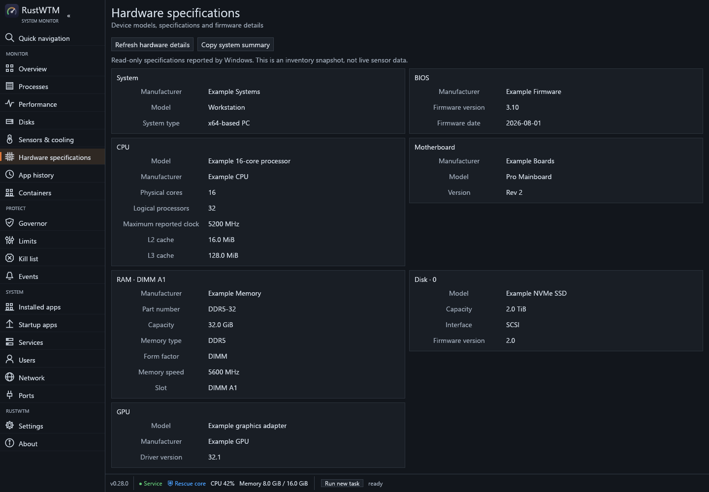
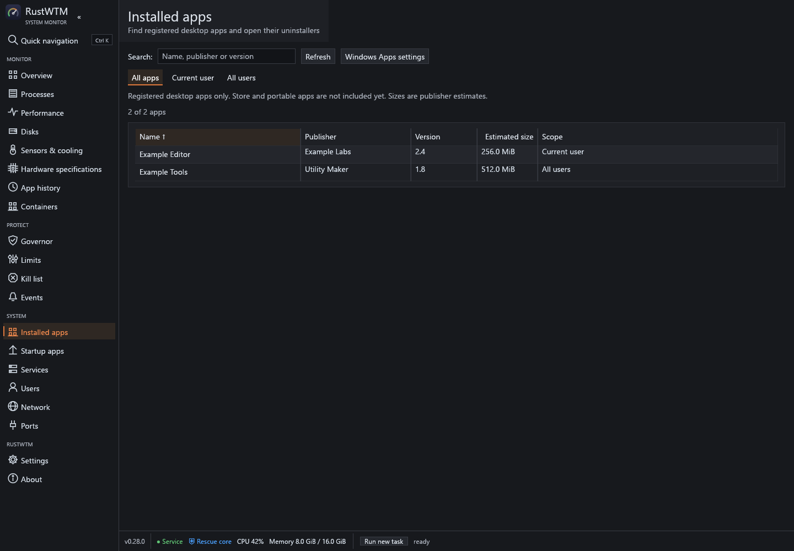
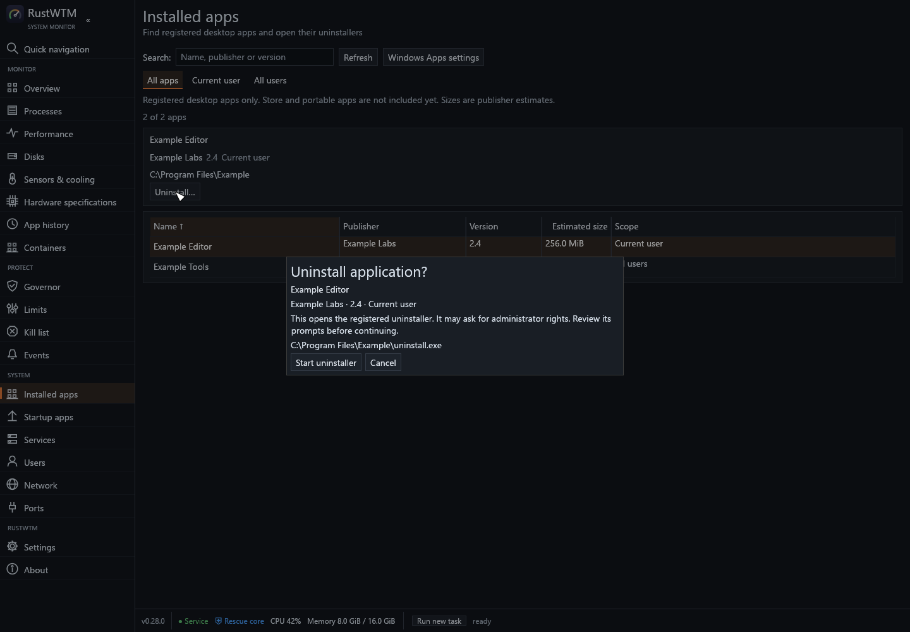

# Hardware inventory and installed application management

Implemented in 0.28.0; delivery order revised 2026-11-10: hardware specifications, installed application
inventory and interactive uninstall, then package-manager updates. This takes
priority over the earlier disk-health-first order in the hardware product plan.
Version 0.29.0 also implements disk health, battery, device-specific
telemetry, Store registrations and reviewed package updates. The sections below
describe the 0.28.0 baseline; see [current implementation and limits](product-expansion.md)
for the newer work and its separate native/VM validation boundaries.

## Hardware specifications

The dedicated Hardware specifications page uses the existing cached CIM worker.
It adds system manufacturer/model/type, BIOS manufacturer/version/date, reported
maximum CPU clock and L2/L3 cache sizes, alongside processor topology, board,
individual RAM modules, disk firmware and graphics identities. Wide pages use
two columns of property cards; compact pages use one. Unknown fields remain
unavailable. Maximum reported clock is not current clock or boost telemetry.

Collection is read-only, outside the frame and sampling loops, with a 25-second
process deadline, 512-KiB response cap, at most 448 items, eight fields per item
and 1024 bytes per field. Refresh is disabled while collection is in flight.
Copy uses the same formatted inventory, including partial category failures.
No serial numbers, device secrets or registry product keys are collected.

## Installed apps

The first implementation reads desktop Add/Remove Programs registrations from
HKCU and both HKLM registry views. It does not use Win32_Product or trigger MSI
consistency checks. Store packages and unregistered portable apps are explicitly
outside this first inventory. The Windows Apps settings shortcut remains
available for those cases and unsupported uninstall commands.

The page provides name/publisher/version search, current-user/all-users filters,
sortable columns, publisher-estimated sizes, install location and an explicit
uninstall action. Different product keys retain separate identities even when
their names match. Machine registry views remain separate. Duplicate aliases
of an identical current-user registration are collapsed.

Each value is read into a fixed 8192-byte buffer before decoding; no allocation
uses a registry-reported length. Unsupported/oversized values stay unavailable.
A scan has a cooperative five-second loop budget, at most 4096 scanned keys and
an 8-MiB retained-string budget. Local registry calls themselves are synchronous
on the worker. Inaccessible roots and reached scan limits produce a partial
result. A single in-flight worker prevents repeated refresh/launch queues.

### Uninstall behavior

1. Select a registration and choose Uninstall. Show its app identity, scope,
   executable and arguments in a confirmation dialog. Cancel launches nothing.
2. Re-read the same hive/view/product key immediately before handoff. If the
   registration changed or disappeared, refuse and ask for a refresh.
3. A Windows Installer product with a valid product-code GUID uses the trusted
   system-directory msiexec with `/x {GUID} /norestart`. No quiet flags are added.
4. Other entries require an unambiguous absolute `.exe` path. Shell/script
   launchers, relative/expandable/ambiguous paths and recognized silent flags
   fall back to Windows Apps settings. Do not use QuietUninstallString, PATH
   lookup, registry deletion, forced elevation or residual-file cleanup.
5. Success means the registered uninstaller was started. Its prompts/UAC remain
   user-operated. The application remains listed until a refresh observes its
   disappearance. A launch error does not imply successful removal.

No uninstaller is launched during automated tests. Pure plans and injectable
re-read/launch seams prove rejection, cancellation and handoff behavior. Native
smoke reads inventory only. Installer mutation proofs belong in disposable VMs.

## Package updates beyond 0.28.0

Build package updates on explicit package-manager identities, not a name-only
join to this registry list. Discovery must retain package ID, source, installed
and available versions, architecture/scope when reported, ambiguity and errors.

Start with read-only discovery and a preview of proposed changes. Then add
per-package interactive updates, refresh/version verification and partial-batch
reporting. Keep concurrency bounded, handle UAC/cancellation and installer exit
codes, and never treat a launched updater as a completed update. Store-package
enumeration and source/agreement handling need their own implementation and
acceptance tests. That follow-up is implemented in 0.29.0 through
the optional signed Microsoft.WinGet.Client binary, with exact source/ID/version
plans and explicit review. Read-only discovery returned 322 package records and
150 current-user Store registrations on the development PC. Installer execution
remains a disposable-VM validation gate.

## Primary references

- [Windows processor clock and cache units](https://learn.microsoft.com/en-us/windows/win32/cimwin32prov/win32-processor)
- [BIOS metadata](https://learn.microsoft.com/en-us/windows/win32/cimwin32prov/win32-bios)
- [Uninstall registry fields](https://learn.microsoft.com/en-us/windows/win32/msi/uninstall-registry-key)
- [Read-only software inventory and Win32_Product side effects](https://learn.microsoft.com/en-us/powershell/scripting/samples/working-with-software-installations)
- [Windows Installer command-line options](https://learn.microsoft.com/en-us/windows/win32/msi/command-line-options)
- [Windows Apps settings URI](https://learn.microsoft.com/en-us/windows/apps/develop/launch/launch-settings)
